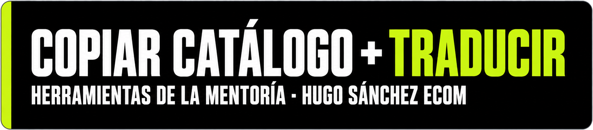
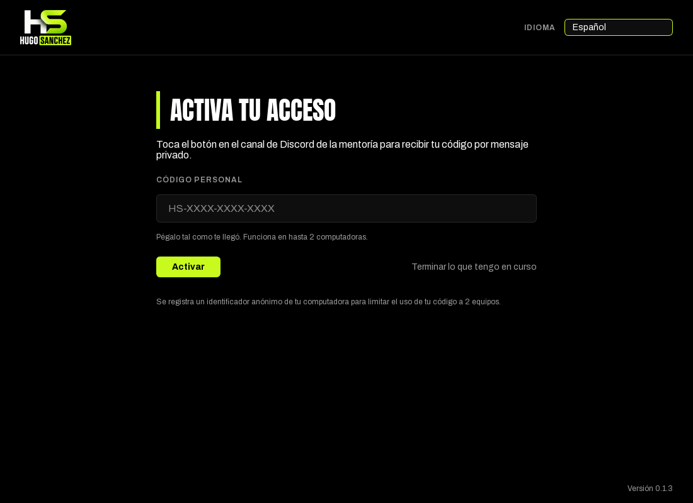
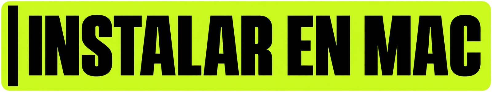
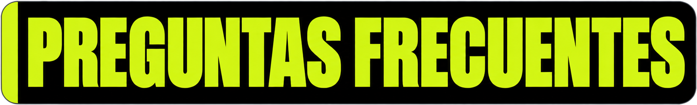

<b>HSE Catálogo copia el catálogo de una tienda Shopify, lo traduce con IA y deja el archivo listo para importar. Gratis para los alumnos de la mentoría Hugo Sanchez Ecom.</b>

<h2 align="center"><a href="https://github.com/coponico/hse-descargas/releases/latest">⬇️ DESCARGAR LA ÚLTIMA VERSIÓN</a></h2>

Windows 10/11 · Mac con chip Apple Silicon

<a href="#quehace">Qué hace</a> · <a href="#comofunciona">Cómo funciona</a> · <a href="#acceso">Acceso con código</a> · <a href="#windows">Instalar en Windows</a> · <a href="#mac">Instalar en Mac</a> · <a href="#conectaria">Conectar tu IA</a> · <a href="#problemas">Problemas comunes</a> · <a href="#preguntas">Preguntas frecuentes</a>

- 📦 **Copia catálogos** de una tienda, una colección o un producto a un CSV listo para Shopify.
- 💱 **Convierte precios y talles** a tu moneda y a tu sistema de talles.
- 🌍 **Traduce con IA** y te muestra el **costo estimado ANTES de gastar**.
- 💸 **Modo económico**: la traducción cuesta la mitad.

La app irá sumando más funciones con el tiempo y te avisa cuando hay una versión nueva.

<a href="#indice">⬆️ Volver al índice</a>

### 1️⃣ Pega la URL de la tienda
La de una tienda Shopify, una colección o un producto. Solo se copia lo que la tienda muestra en público.

### 2️⃣ Elige qué copiar
Marca productos sueltos o colecciones enteras.

### 3️⃣ Ajusta las opciones
Todo es opcional: si no tocas nada, se copia tal cual. Puedes cambiar el vendor, el estado (borrador o activo), los precios, los talles y traducir con IA.

### 4️⃣ Guarda el CSV e impórtalo en Shopify
Elige la carpeta, genera el archivo y súbelo en tu tienda: **Productos → Importar**.

### 💵 ¿Y el costo?
Antes de empezar ves una **estimación en rango** (mínimo, probable y máximo). Puedes poner un **presupuesto máximo** opcional y, si se pasa, la traducción **se pausa sola**. El **modo económico cuesta la mitad** y puede tardar **hasta 24 horas**.

<a href="#indice">⬆️ Volver al índice</a>

Para usar la app necesitas tu **código personal**.

**Cómo conseguirlo**
1. Entra al Discord de la mentoría y toca el **botón del canal de acceso**.
2. Tu código llega por **mensaje privado**. Tiene este formato: `HS-XXXX-XXXX-XXXX`.

**Cómo activarlo**
1. Abre la app y pega el código tal como te llegó.
2. Pulsa **Activar**.

**Lo que debes saber**
- ⏳ El código dura **30 días**. Cuando vence, toca otra vez el botón en Discord y recibes uno nuevo.
- 🔔 La app te avisa **5 días antes** de que venza.
- 💻 Funciona en **hasta 2 computadoras**.
- 🙅 Es **personal e intransferible**, y de **uso exclusivo para alumnos de la mentoría**.
- 🔒 **Privacidad:** se registra un identificador anónimo de tu computadora para limitar el uso de tu código a 2 equipos.
- 🤖 El bot de Discord figura como «desconectado», pero **funciona igual**.

<a href="#indice">⬆️ Volver al índice</a>

> [!WARNING]
> **⚠️ ¿Windows o Mac bloquean la app? Es normal: la app es gratuita y todavía no tiene certificado de firma de pago. Abre tu sistema aquí abajo.**

### Qué necesitas
Windows 10 u 11 de 64 bits.

### Pasos
1. Entra a la [última versión](https://github.com/coponico/hse-descargas/releases/latest) y descarga **HSE-Catalogo.exe**.
2. Ábrelo con doble clic.

### 🟢 Si aparece «Windows protegió tu PC» (SmartScreen)
Haz clic en **Más información** y luego en **Ejecutar de todas formas**. Pasa porque la app no tiene un certificado de pago. Solo se pide la primera vez.

### 🟡 Si el archivo aparece bloqueado
Clic derecho en **HSE-Catalogo.exe** → **Propiedades** → marca **Desbloquear** (abajo, en la pestaña General) → **Aceptar**.

### 🔴 Si Windows 11 dice que la app fue bloqueada y no ofrece ninguna opción
Eso es **Smart App Control**, una protección de Windows 11 que bloquea las apps sin firma digital. Suele venir activada en instalaciones nuevas.

**¿Por qué pasa?** La app es gratuita y todavía no tiene un certificado de firma de pago. La app no hace nada peligroso: solo lee catálogos públicos y guarda archivos donde tú le indicas.

Para poder abrirla hay que desactivar Smart App Control:

1. Abre **Seguridad de Windows**.
2. Entra a **Control de aplicaciones y navegador**.
3. Pulsa **Configuración de Smart App Control**.
4. Elige **Desactivado**.

> [!WARNING]
> **Antes de hacerlo, ten esto claro:**
> - Es una decisión de seguridad de tu equipo. **No es algo que todos deban hacer.**
> - Según Microsoft, en versiones recientes de Windows 11 se puede volver a activar desde el mismo lugar; en otras versiones puede ser necesario restablecer o reinstalar Windows. No cuentes con poder volver atrás fácilmente.
> - Las demás protecciones (Microsoft Defender y SmartScreen) siguen activas.
> - Hazlo solo si estás de acuerdo. Si prefieres no hacerlo, puedes usar la app en otra computadora (por ejemplo, una con Windows 10 o una Mac).

<a href="#indice">⬆️ Volver al índice</a>

### Qué necesitas
Una Mac con chip Apple Silicon (M1 o posterior). Las Mac Intel no están soportadas.

### Pasos
1. Entra a la [última versión](https://github.com/coponico/hse-descargas/releases/latest) y descarga **HSE-Catalogo-mac.zip**.
2. Haz doble clic para descomprimirlo.
3. Arrastra **HSE Catalogo** a la carpeta **Aplicaciones**.
4. La primera vez, ábrelo con **clic derecho → Abrir**.

### Si la Mac no te deja abrirla
Ve a **Ajustes del Sistema → Privacidad y seguridad** y pulsa **Abrir igualmente**.

**¿Por qué pasa?** La app no está firmada con una cuenta de desarrollador de Apple, que es de pago. Es normal y solo se pide la primera vez.

<a href="#indice">⬆️ Volver al índice</a>

<h2 align="center">🔑 Conectar tu IA</h2>

Para traducir, la app usa **tu propia API key**. Funciona con **OpenAI**, **Anthropic (Claude)**, **Gemini** y **DeepSeek** (este último, poco recomendado).

1. Abre **Conectar IA** (arriba a la derecha) y elige tu proveedor.
2. Pega tu key y pulsa **Guardar**.
3. Pulsa **Probar key** para comprobar que funciona.

La app trae una **guía por proveedor** para sacar la key y cargar crédito (botón **¿Cómo obtengo mi API key?**).

> 🔒 **Tu key se guarda de forma segura en tu computadora y nunca se comparte.**

<a href="#indice">⬆️ Volver al índice</a>

**La app no abre.**
Revisa los requisitos y sigue los pasos de tu sistema en las secciones de instalación.

**Dice «Ese código no es válido».**
Revisa que lo copiaste completo, con el formato `HS-XXXX-XXXX-XXXX`.

**Dice «Tu código venció».**
Toca otra vez el botón en el Discord de la mentoría, recibe un código nuevo y pégalo en la app.

**Dice «Tu acceso está bloqueado».**
Escribe a un mentor para resolverlo. Cuando esté resuelto, pulsa **Activar**.

**Dice «Tu código ya se usa en 2 equipos».**
Si cambiaste de computadora, escribe a un mentor para liberar un lugar y luego pulsa **Activar**.

**Dice que no hay conexión con el servicio de acceso.**
Revisa tu internet y vuelve a intentar.

**Dice que la clave de IA no es válida.**
Entra a **Conectar IA**, vuelve a pegar la key completa y pulsa **Probar key**. Revisa que sea del proveedor que elegiste.

**Dice que no tengo crédito.**
Carga saldo en tu cuenta del proveedor de IA y retoma el trabajo: lo ya traducido queda guardado.

**Se cortó una traducción, ¿cómo sigo?**
Abre la app: te ofrece **Continuar** el trabajo sin terminar. Lo ya traducido no se paga dos veces.

**¿Dónde se guarda lo copiado?**
En la carpeta que elijas en el último paso (por ejemplo, Documentos), como un archivo CSV.

<a href="#indice">⬆️ Volver al índice</a>

**¿Cuánto cuesta traducir?**
Depende del idioma, del largo de los textos y del modelo. Antes de empezar la app te muestra un costo estimado en rango. Con el modelo más barato suelen ser centavos por producto, y el modo económico cuesta la mitad.

**¿Qué pasa si se acaba el crédito?**
La traducción se detiene. Carga saldo en tu cuenta del proveedor y continúa: lo ya traducido queda guardado y no se paga dos veces.

**¿Puedo traducir cualquier idioma?**
Puedes elegir entre los idiomas que ofrece la app. La calidad depende del modelo de IA que uses.

**¿Mi catálogo o mi clave se envían a algún servidor tuyo?**
No. Tu clave se guarda en tu computadora y solo viaja al proveedor de IA que elijas. El único servicio nuestro valida tu código de acceso; no ve tu clave ni tu catálogo.

**¿Cómo me actualizo?**
La app avisa sola cuando hay una versión nueva. En **Windows** se actualiza al reiniciarla. En **Mac** debes reemplazarla a mano: descarga la nueva y arrástrala a Aplicaciones.

<a href="#indice">⬆️ Volver al índice</a>

<b>💬 Soporte:</b> abre un ticket en el Discord de la mentoría.

