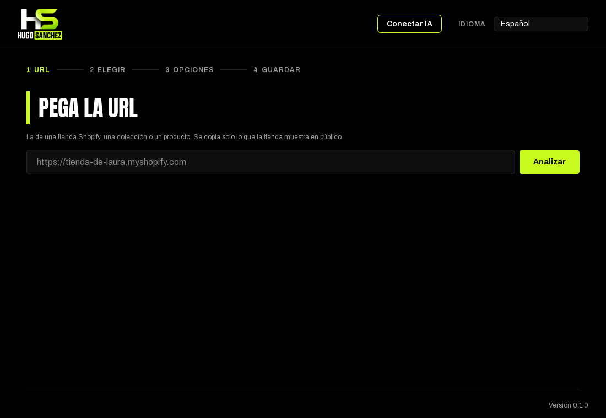
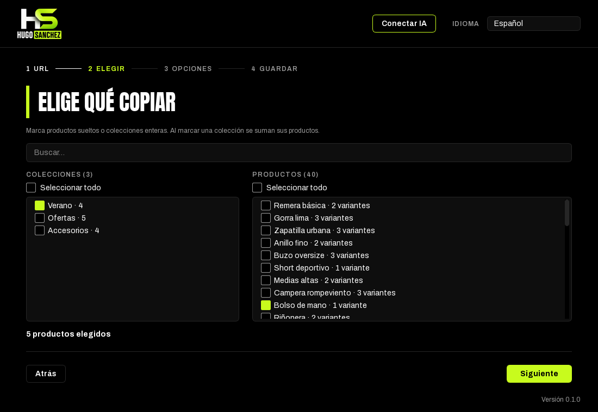
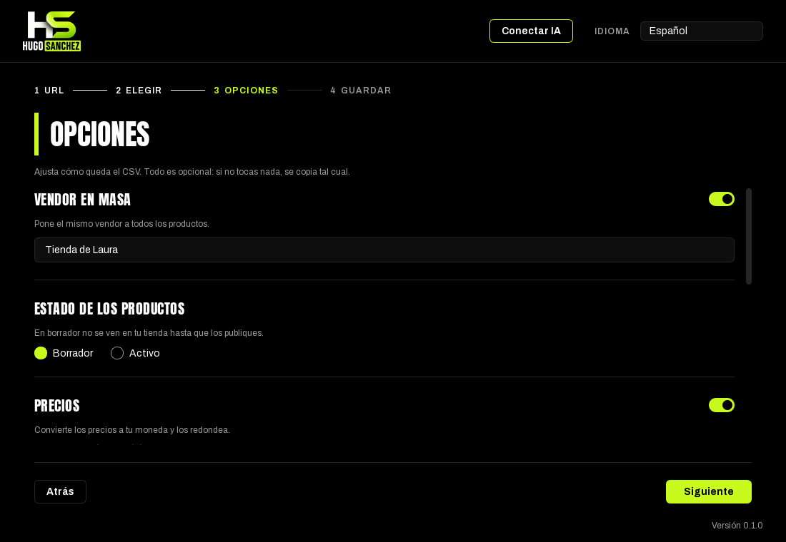
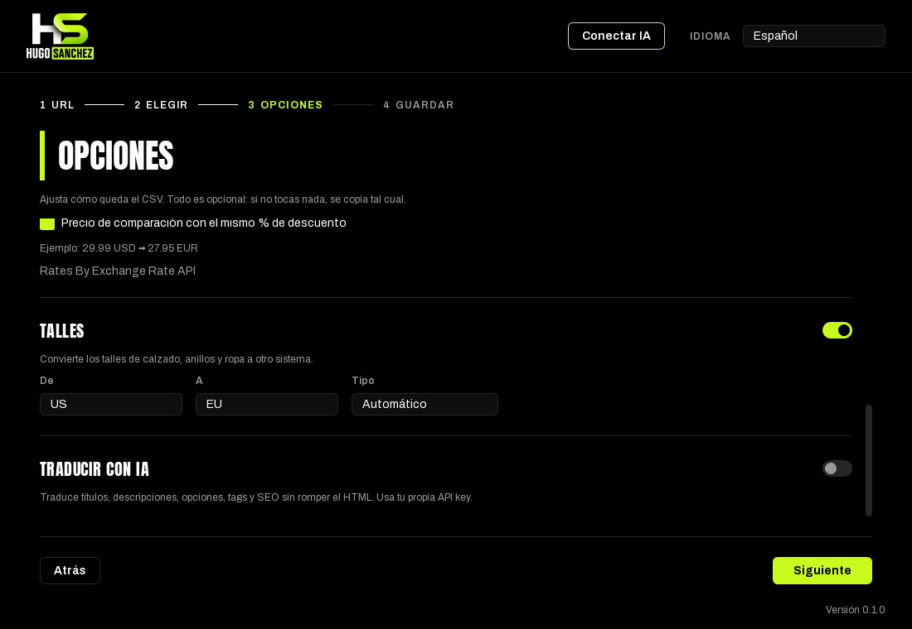
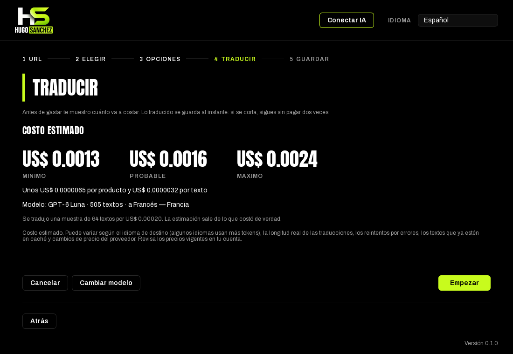
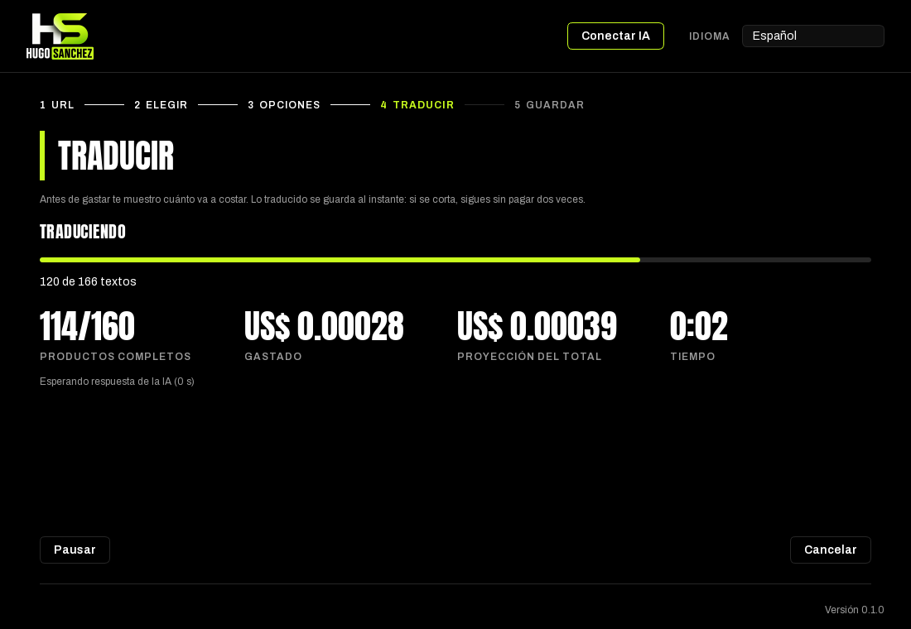
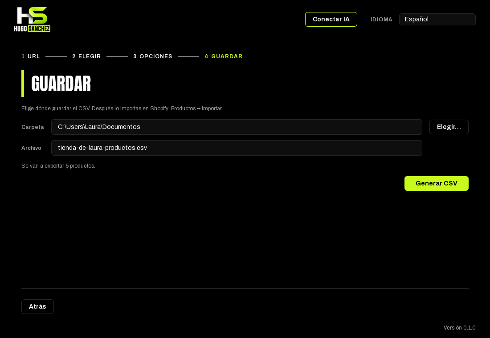
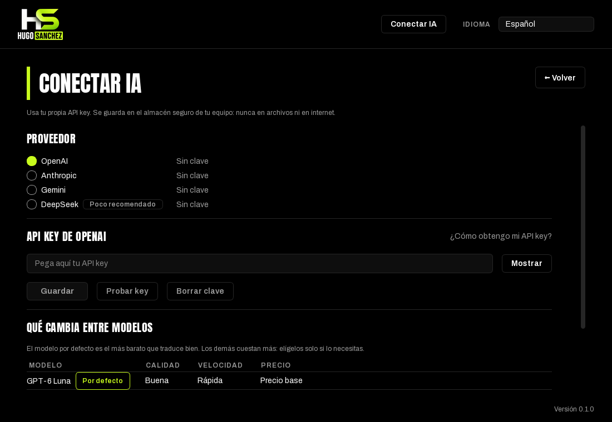

# HSE Catálogo

**Copia el catálogo de una tienda Shopify, tradúcelo con IA y deja el CSV listo para importar.**
Gratis para los alumnos de la mentoría Hugo Sanchez Ecom.

### [⬇️ Descargar la última versión](https://github.com/coponico/hse-descargas/releases/latest)

---

## Cómo funciona

### 1. Pega la URL de la tienda
La de una tienda Shopify, una colección o un producto. Solo se copia lo que la tienda muestra en público.

### 2. Elige qué copiar
Marca productos sueltos o colecciones enteras.

### 3. Ajusta las opciones
Todo es opcional: si no tocas nada, se copia tal cual. Puedes cambiar el vendor, el estado (borrador o activo), los precios y la moneda, los talles y traducir con IA.

**Si activas Traducir con IA**, antes de empezar ves cuánto va a costar:

Y mientras traduce, ves el avance y lo gastado:

### 4. Guarda el CSV e impórtalo en Shopify
Elige la carpeta, genera el archivo y súbelo en tu tienda: **Productos → Importar**.

---

## Instalación en Windows

**Necesitas:** Windows 10 u 11 de 64 bits.

1. Entra a la [última versión](https://github.com/coponico/hse-descargas/releases/latest) y descarga **HSE-Catalogo.exe**.
2. Ábrelo con doble clic.

**¿Aparece «Windows protegió tu PC»?** Haz clic en **Más información** y luego en **Ejecutar de todas formas**.
Pasa porque la app no tiene un certificado de pago (es lo que Windows usa para reconocer programas conocidos). Es normal y solo se pide la primera vez.

## Instalación en Mac

**Necesitas:** una Mac con chip Apple Silicon (M1 o posterior). Las Mac Intel antiguas no están soportadas.

1. Entra a la [última versión](https://github.com/coponico/hse-descargas/releases/latest) y descarga **HSE-Catalogo-mac.zip**.
2. Haz doble clic para descomprimirlo.
3. Arrastra **HSE Catalogo** a la carpeta **Aplicaciones**.
4. La primera vez, ábrelo con **clic derecho → Abrir**.

Si Mac no te deja abrirla: ve a **Ajustes del Sistema → Privacidad y seguridad** y pulsa **Abrir igualmente**.
Pasa porque la app no está firmada con una cuenta de desarrollador de Apple (es de pago). Es normal y solo se pide la primera vez.

---

## Conecta tu IA

Para traducir, la app usa **tu propia API key**. Funciona con OpenAI, Anthropic (Claude), Gemini y DeepSeek (este último, poco recomendado).

1. Abre **Conectar IA** (arriba a la derecha) y elige tu proveedor.
2. Pega tu key.
3. Pulsa **Probar key** para comprobar que funciona.

Dentro de la app hay una guía por proveedor para sacar la key y cargar crédito (botón **¿Cómo obtengo mi API key?**).

🔒 Tu key se guarda de forma segura en tu computadora y nunca se comparte.

## Cuánto cuesta traducir

La app te muestra el **costo estimado antes de gastar nada**. Además puedes poner un **presupuesto máximo** (opcional): si la traducción se pasa, se pausa sola.

Como idea orientativa, con el modelo más barato suelen ser unos centavos por producto. El costo real depende del idioma, del largo de los textos y de los precios de tu proveedor.

## Actualizaciones

La app avisa sola cuando hay una versión nueva y la descarga ya verificada.
En Windows se reemplaza sola al reiniciar; en Mac la reemplazas a mano (arrastrando la nueva a Aplicaciones).

---

## Preguntas frecuentes

**No se abre.**
Revisa que cumples los requisitos y sigue los pasos de «Windows protegió tu PC» (Windows) o clic derecho → Abrir (Mac).

**Me da error de clave.**
Entra a Conectar IA, vuelve a pegar la key completa y pulsa Probar key. Revisa que sea del mismo proveedor que elegiste.

**Dice que no tengo crédito.**
Carga saldo en tu cuenta del proveedor y retoma: lo ya traducido queda guardado.

**Se cortó a la mitad, ¿cómo sigo?**
Abre la app: te ofrece **Continuar** el trabajo sin terminar. Lo ya traducido no se paga dos veces.

**¿Dónde se guarda lo copiado?**
En la carpeta que elijas en el paso 4. El trabajo en curso queda guardado en la carpeta de datos de la app.

**¿Cómo borro mi clave?**
En Conectar IA, elige el proveedor y pulsa **Borrar clave**.

---

## Soporte

¿Algo no funciona? Escribe en el Discord de la mentoría.
