<p align="center">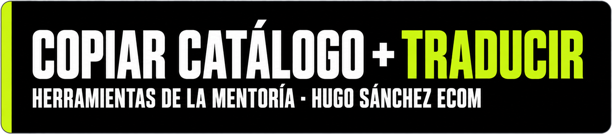</p>

<p align="center"><b>HSE Catálogo copia el catálogo de una tienda Shopify, lo traduce con IA y deja el archivo listo para importar. También cambia el fondo de tus fotos de producto con IA. Gratis para los alumnos de la mentoría Hugo Sanchez Ecom.</b></p>

<h2 align="center"><a href="https://github.com/coponico/hse-descargas/releases/latest">⬇️ DESCARGAR LA ÚLTIMA VERSIÓN</a></h2>

<p align="center"><sub>Windows 10/11 · Mac con chip Apple Silicon</sub></p>

<a id="indice"></a>

<p align="center">
<a href="#quehace">Qué hace</a> · <a href="#comofunciona">Cómo funciona</a> · <a href="#cambiarfondo">Cambiar fondo</a> · <a href="#acceso">Acceso con código</a> · <a href="#windows">Instalar en Windows</a> · <a href="#mac">Instalar en Mac</a> · <a href="#conectaria">Conectar tu IA</a> · <a href="#problemas">Problemas comunes</a> · <a href="#preguntas">Preguntas frecuentes</a>
</p>

<p align="center"></p>

<a id="quehace"></a>
<p align="center"></p>

La app tiene **dos pestañas**: **Copiar catálogo** y **Cambiar fondo**.

- 📦 **Copia catálogos** de una tienda, una colección o un producto a un CSV listo para Shopify.
- 💱 **Convierte precios y talles** a tu moneda y a tu sistema de talles.
- 🌍 **Traduce con IA** y te muestra el **costo estimado ANTES de gastar**.
- 💸 **Modo económico**: la traducción cuesta la mitad.
- 🖼️ **Cambia el fondo de tus fotos** de producto con IA (OpenAI o Gemini), con una prueba de 3 fotos antes de gastar.

La app irá sumando más funciones con el tiempo y te avisa cuando hay una versión nueva.

<p align="center"><a href="#indice">⬆️ Volver al índice</a></p>

<p align="center"></p>

<a id="comofunciona"></a>
<p align="center">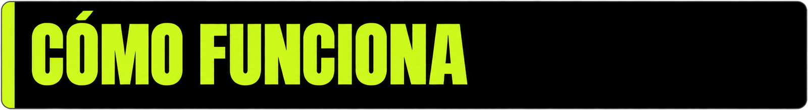</p>

Estos pasos son de la pestaña **Copiar catálogo**. Más abajo está [Cambiar fondo](#cambiarfondo).

### 1️⃣ Pega la URL de la tienda
La de una tienda Shopify, una colección o un producto. Solo se copia lo que la tienda muestra en público.

<p align="center">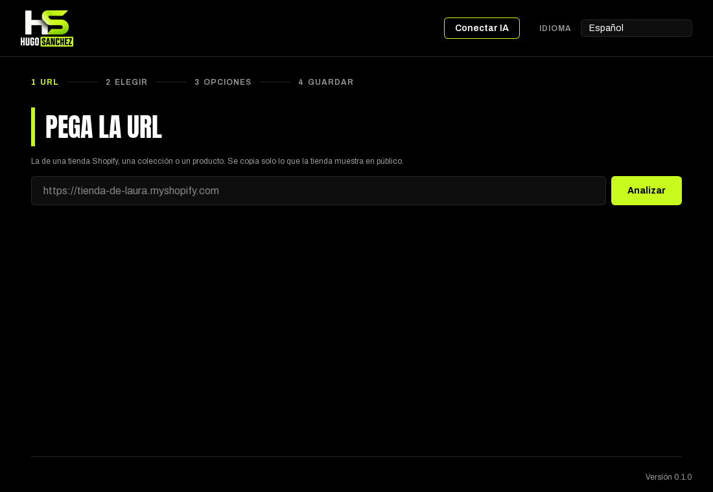</p>

### 2️⃣ Elige qué copiar
Marca productos sueltos o colecciones enteras.

<p align="center">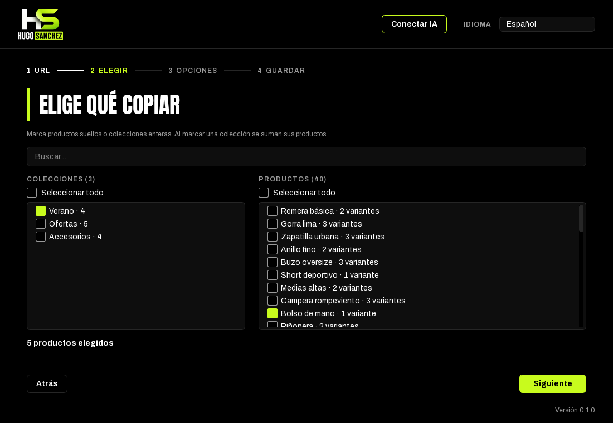</p>

### 3️⃣ Ajusta las opciones
Todo es opcional: si no tocas nada, se copia tal cual. Puedes cambiar el vendor, el estado (borrador o activo), los precios, los talles y traducir con IA.

<p align="center">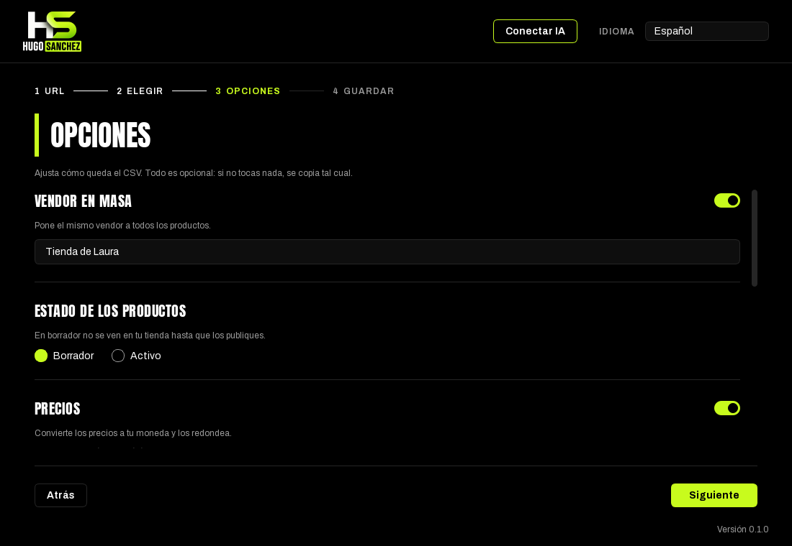</p>

### 4️⃣ Guarda el CSV e impórtalo en Shopify
Elige la carpeta, genera el archivo y súbelo en tu tienda: **Productos → Importar**.

<p align="center">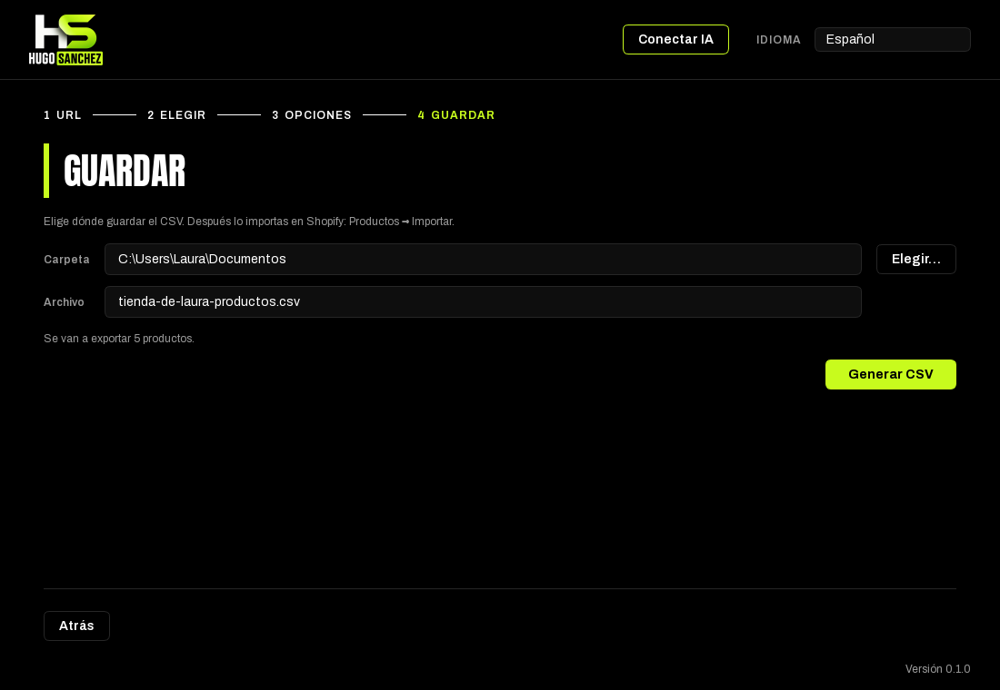</p>

### 💵 ¿Y el costo?
Antes de empezar ves una **estimación en rango** (mínimo, probable y máximo). Puedes poner un **presupuesto máximo** opcional y, si se pasa, la traducción **se pausa sola**. El **modo económico cuesta la mitad** y puede tardar **hasta 24 horas**.

<p align="center">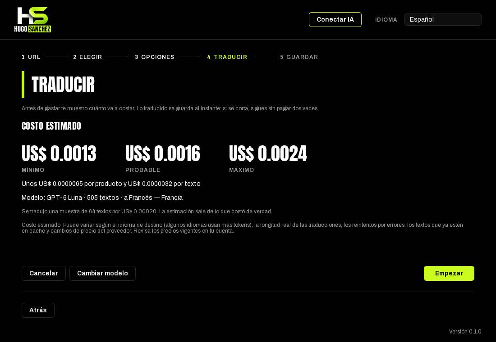</p>

<p align="center"><a href="#indice">⬆️ Volver al índice</a></p>

<p align="center"></p>

<a id="cambiarfondo"></a>
<h2 align="center">🖼️ Cambiar fondo</h2>

Reemplaza el **fondo de las fotos de tus productos** con IA y deja el producto como está. Sirve si vendes con Shopify y quieres fotos con **fondo blanco** o con un mismo estilo en toda la tienda, sin hacer una sesión nueva ni editar foto por foto. Necesita tu código de acceso, igual que el resto de la app.

### Cómo se usa
Abre la pestaña **Cambiar fondo** y sigue estos pasos:

1. **Fotos.** Elige **Carpeta** (una carpeta de tu computadora) o **CSV de Shopify** (la app baja las fotos de la columna *Product image URL*) y pulsa **Elegir carpeta…** o **Elegir CSV…**.
2. **Productos.** Aparece la lista con cuántas fotos tiene cada producto. Vienen todos marcados; usa **Seleccionar todos** o **Deseleccionar todos**. Solo se procesan (y se cobran) los marcados.

<p align="center">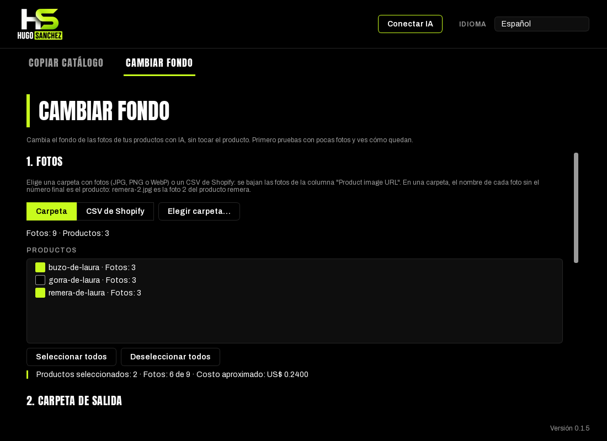</p>

3. **Carpeta de salida.** Es donde quedarán las fotos nuevas. La app recuerda la última que usaste y siempre la muestra completa, con los botones **Cambiar…** y **Abrir carpeta**.
4. **Estilo del fondo.** **Blanco puro**, **Gris claro de estudio**, **Crema / beige**, **Lifestyle minimalista** o **Personalizado**. Con *Personalizado* describes el fondo con tus palabras o pulsas **Copiar instrucciones para que una IA arme tu prompt**: copia un texto que pegas en cualquier chat de IA. Completa lo que está entre corchetes (tus productos, el estilo de tu marca y dónde usarás las fotos); la IA te responde una descripción corta del fondo, en inglés, y la pegas en la app.
5. **IA.** Solo **OpenAI** o **Gemini** (son las que editan imágenes), más el modelo. Usa la misma key de [Conectar tu IA](#conectaria).
6. **Presupuesto máximo** (opcional). Si se llega, la app frena y lo hecho queda guardado.
7. Pulsa **Preparar fotos y estimar costo**. Ves el **costo estimado** (un rango) **antes** de gastar.
8. Pulsa **Probar con 3 fotos**. La app elige 3 fotos de productos distintos y te muestra el **antes/después** y el costo real. Con **Guardar estas 3** las guardas en la carpeta de salida y ves la ruta completa. Si te gustan, pulsa **Se ven bien: procesar las restantes**: las 3 ya hechas no se pagan otra vez. Si no, pulsa **Cambiar estilo**.

<p align="center">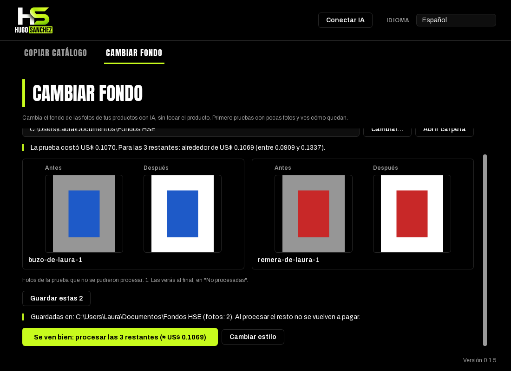</p>

9. **Revisa.** Cada foto muestra el antes y el después (haz clic en una imagen para verla en grande). Todas vienen con la casilla **Usar esta** marcada: **desmarca las que no quieras**. Las que la IA rechaza quedan en **No procesadas**, con el motivo y un botón **Reintentar**.

<p align="center">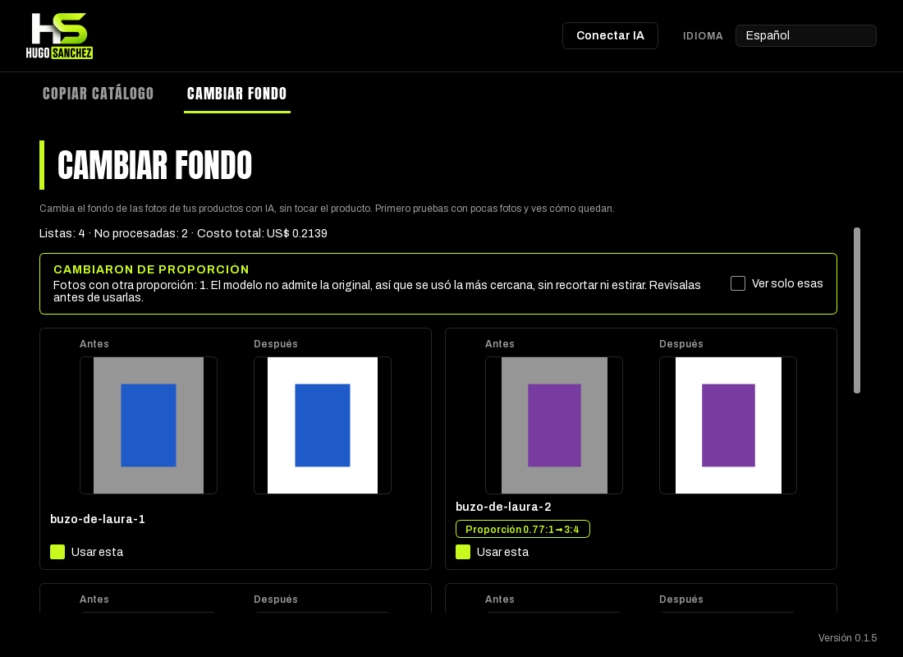</p>

10. Pulsa **Guardar en una carpeta…**. La app te dice dónde quedó todo y puedes pulsar **Abrir carpeta**.

### Cómo queda la carpeta de salida
La primera vez la app propone *Documentos → Fondos HSE*. Adentro:

```
Fondos HSE/
├── fondos.csv
├── remera-de-laura/
│   ├── remera-de-laura-1.jpg
│   └── remera-de-laura-2.jpg
├── taza-de-laura/
│   └── taza-de-laura-1.jpg
└── descartadas/            (solo si desmarcaste alguna)
    └── taza-de-laura/
        └── taza-de-laura-2.jpg
```

Hay **una subcarpeta por producto**, con el handle como nombre. El número final del archivo es la posición de la foto. `fondos.csv` está en la raíz y trae, por cada foto: su ruta, su handle, su posición, la imagen original, su estado y, si no se pudo procesar, el motivo.

Si eliges una carpeta de fotos (no un CSV), el producto es el nombre del archivo sin el número final: `remera-2.jpg` es la foto 2 del producto `remera`.

### 💸 ¿Y el costo?
Se cobra **por foto** y depende del modelo y de la calidad. La app muestra una estimación antes de empezar y la prueba de 3 fotos mide el costo real. Los precios los fija cada proveedor y cambian con el tiempo: revísalos en tu cuenta.

> [!WARNING]
> **Dos avisos honestos**
> - 👀 **La IA puede alterar el producto** (colores, logos, textos, detalles), aunque la app le pida que no. **Mira siempre el antes/después** de cada foto antes de usarla.
> - 🏷️ Las imágenes de **Gemini** llevan una **marca invisible llamada SynthID**, que indica que fueron hechas con IA. No se ve en la foto.

🔒 Para editarlas, tus fotos se envían al proveedor de IA que elijas (OpenAI o Gemini).

<p align="center"><a href="#indice">⬆️ Volver al índice</a></p>

<p align="center"></p>

<a id="acceso"></a>
<p align="center"></p>

Para usar la app necesitas tu **código personal**.

**Cómo conseguirlo**
1. Entra al Discord de la mentoría y toca el **botón del canal de acceso**.
2. Tu código llega por **mensaje privado**. Tiene este formato: `HS-XXXX-XXXX-XXXX`.

**Cómo activarlo**
1. Abre la app y pega el código tal como te llegó.
2. Pulsa **Activar**.

<p align="center">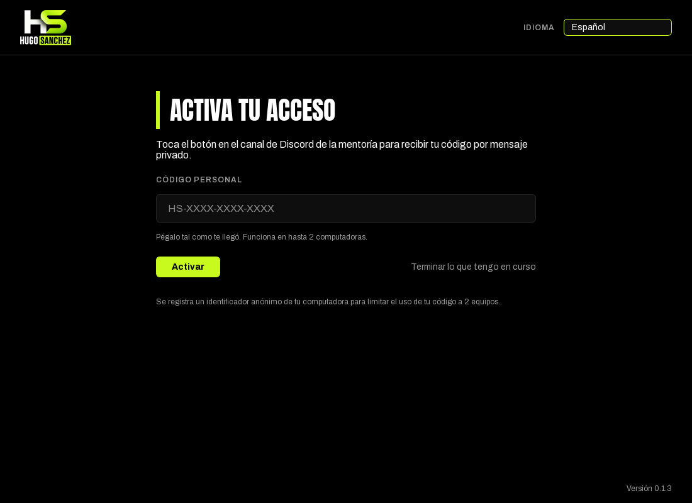</p>

**Lo que debes saber**
- ⏳ El código dura **30 días**. Cuando vence, toca otra vez el botón en Discord y recibes uno nuevo.
- 🔔 La app te avisa **5 días antes** de que venza.
- 💻 Funciona en **hasta 2 computadoras**.
- 🙅 Es **personal e intransferible**, y de **uso exclusivo para alumnos de la mentoría**.
- 🔒 **Privacidad:** se registra un identificador anónimo de tu computadora para limitar el uso de tu código a 2 equipos.
- 🤖 El bot de Discord figura como «desconectado», pero **funciona igual**.

<p align="center"><a href="#indice">⬆️ Volver al índice</a></p>

<p align="center"></p>

> [!WARNING]
> **⚠️ ¿Windows o Mac bloquean la app? Es normal: la app es gratuita y todavía no tiene certificado de firma de pago. Abre tu sistema aquí abajo.**

<a id="windows"></a>
<p align="center"></p>

### Qué necesitas
Windows 10 u 11 de 64 bits.

### Pasos
1. Entra a la [última versión](https://github.com/coponico/hse-descargas/releases/latest) y descarga **HSE-Catalogo.exe**.
2. Ábrelo con doble clic.

¿Prefieres la consola? Mira [instalar por PowerShell](#consola-windows).

<a id="consola-windows"></a>
### ⌨️ Instalar por consola (opcional)
No hace falta instalar nada extra: usa **Windows PowerShell**, que ya viene con Windows 10 y 11. Abre el menú Inicio, escribe **PowerShell** y ábrelo. Pega cada bloque completo y pulsa Enter.

**1. Descargar la última versión** a tu carpeta Descargas:

```powershell
$ProgressPreference = 'SilentlyContinue'
$base = "https://github.com/coponico/hse-descargas/releases/latest/download"
$exe  = "$env:USERPROFILE\Downloads\HSE-Catalogo.exe"
Invoke-WebRequest "$base/HSE-Catalogo.exe" -OutFile $exe
```

**2. Verificar el SHA-256** (opcional, pero recomendado). Sigue en la misma ventana:

```powershell
Invoke-WebRequest "$base/HSE-Catalogo.exe.sha256" -OutFile "$exe.sha256"
$esperado = ((Get-Content "$exe.sha256" -Raw).Trim() -split '\s+')[0]
$real = (Get-FileHash $exe -Algorithm SHA256).Hash.ToLower()
if ($real -eq $esperado) { "OK: el archivo es el original" } else { "NO COINCIDE: no lo abras" }
```

**3. Abrir la app:**

```powershell
Start-Process $exe
```

Si dice **OK**, la app se abre. Si dice **NO COINCIDE**, borra el archivo y vuelve a descargarlo. El enlace `latest` siempre apunta a la última versión.

> [!NOTE]
> Bajarla así evita el aviso de SmartScreen, pero **no evita Smart App Control** (Windows 11). Si bloquea la app, mira [qué hacer con Smart App Control](#smartappcontrol).

### 🟢 Si aparece «Windows protegió tu PC» (SmartScreen)
Haz clic en **Más información** y luego en **Ejecutar de todas formas**. Pasa porque la app no tiene un certificado de pago. Solo se pide la primera vez.

### 🟡 Si el archivo aparece bloqueado
Clic derecho en **HSE-Catalogo.exe** → **Propiedades** → marca **Desbloquear** (abajo, en la pestaña General) → **Aceptar**.

<a id="smartappcontrol"></a>
### 🔴 Si Windows 11 dice que la app fue bloqueada y no ofrece ninguna opción
Eso es **Smart App Control**, una protección de Windows 11 que bloquea las apps sin firma digital. Suele venir activada en instalaciones nuevas.

**¿Por qué pasa?** La app es gratuita y todavía no tiene un certificado de firma de pago. La app no hace nada peligroso: solo lee catálogos públicos y guarda archivos donde tú le indicas.

**No existe una excepción para una sola app:** Microsoft solo permite apagar o encender Smart App Control para todo el equipo.

**Antes de apagarlo, actualiza Windows** (**Configuración → Windows Update**). Con las actualizaciones recientes, Microsoft permite volver a encenderlo sin reinstalar Windows. En un equipo sin actualizar, apagarlo puede ser definitivo.

Para poder abrir la app:

1. Abre **Seguridad de Windows**.
2. Entra a **Control de aplicaciones y navegador**.
3. Pulsa **Configuración de Smart App Control**.
4. Elige **Desactivado**.
5. Abre **HSE-Catalogo.exe**.

*(Atajo: pulsa Windows + R, escribe `windowsdefender://smartapp/` y Enter.)*

**¿Y volver a encenderlo?** Si tu Windows está actualizado, puedes volver al mismo lugar y elegir **Activado**. Pero ojo: **con Smart App Control encendido la app no abre**, porque Windows revisa cada app cuando se abre y esta no tiene firma de pago. Si quieres seguir usándola, déjalo apagado, o apágalo cada vez que quieras usarla.

> [!WARNING]
> **Antes de hacerlo, ten esto claro:**
> - Es una decisión de seguridad de tu equipo. **No es algo que todos deban hacer.**
> - Con Smart App Control apagado, Windows deja de bloquear las apps sin firma ni reputación. Las demás protecciones (Microsoft Defender y SmartScreen) siguen activas.
> - Hazlo solo si estás de acuerdo. Si prefieres no hacerlo, puedes usar la app en otra computadora (por ejemplo, una con Windows 10 o una Mac).

<p align="center"><a href="#indice">⬆️ Volver al índice</a></p>

<p align="center"></p>

<a id="mac"></a>
<p align="center">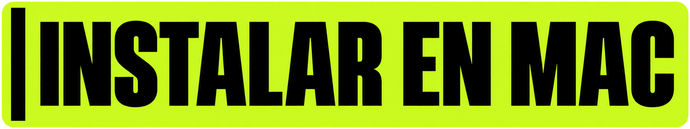</p>

### Qué necesitas
Una Mac con **chip Apple (M1 o más nuevo)**. Las Mac con procesador **Intel** no están soportadas: el paquete no abre en ellas. Para saber cuál tienes: menú Apple → **Acerca de esta Mac**.

### Pasos
1. Entra a la [última versión](https://github.com/coponico/hse-descargas/releases/latest) y descarga **HSE-Catalogo-mac.zip**.
2. Haz doble clic para descomprimirlo.
3. Arrastra **HSE Catalogo** a la carpeta **Aplicaciones**.
4. Ábrela. macOS mostrará un aviso (es normal, no está notarizada por Apple): pulsa **Aceptar** (nunca «Trasladar a la Papelera»).
5. Abre **Ajustes del Sistema → Privacidad y seguridad**, baja hasta **Seguridad** y pulsa **Abrir igualmente**.
6. Escribe tu contraseña o usa Touch ID y pulsa **Abrir**.

Más detalle en [abrir la app por primera vez](#abrir-mac).

¿Prefieres la Terminal? Mira [instalar por Terminal](#consola-mac).

<a id="consola-mac"></a>
### ⌨️ Instalar por Terminal (opcional)
Solo para **Macs con chip Apple (M1 o más nuevo)**. No hace falta instalar nada extra: usa **Terminal** y herramientas que ya trae macOS (`curl`, `shasum`, `ditto`). Abre **Terminal** (Spotlight → «Terminal»). Pega cada bloque completo y pulsa Enter. La app se instala en tu carpeta personal `~/Applications`, que no pide permisos.

**1. Comprobar el chip.** Debe decir `arm64`. Si dice `x86_64`, tu Mac es Intel y no está soportada:

```bash
uname -m
```

**2. Descargar la última versión** a tu carpeta Descargas:

```bash
cd "$HOME/Downloads"
BASE="https://github.com/coponico/hse-descargas/releases/latest/download"
curl -L -O "$BASE/HSE-Catalogo-mac.zip"
curl -L -O "$BASE/HSE-Catalogo-mac.zip.sha256"
```

**3. Verificar el SHA-256** (opcional, pero recomendado). Debe decir `OK`:

```bash
shasum -a 256 -c HSE-Catalogo-mac.zip.sha256
```

Si dice **FAILED**, borra el zip y vuelve a descargarlo.

**4. Instalar y abrir:**

```bash
mkdir -p "$HOME/Applications"
rm -rf "$HOME/Applications/HSE Catalogo.app"
ditto -x -k "$HOME/Downloads/HSE-Catalogo-mac.zip" "$HOME/Applications"
open "$HOME/Applications/HSE Catalogo.app"
```

Al abrir, macOS muestra un aviso. Es normal: sigue los pasos de [abrir la app por primera vez](#abrir-mac).

> [!TIP]
> Si prefieres no usar comandos para instalar, abre el zip en Finder y arrastra **HSE Catalogo** a **Aplicaciones**.

> [!NOTE]
> 🧪 **Probado en una Mac con chip Apple:** funcionaron la descarga, la verificación del SHA-256, la instalación en `~/Applications` y la apertura con el paso de Seguridad. Si algo falla, avísanos en el Discord.

<a id="abrir-mac"></a>
### 🔓 Abrir la app por primera vez (instalación normal)
Al abrir la app, macOS dice: «No se ha abierto HSE Catalogo. Apple no ha podido verificar que HSE Catalogo no contenga software malicioso». **Es normal y pasa con cualquier forma de instalar** (navegador o Terminal): la app es gratuita y Apple no la ha notarizado, porque eso requiere una cuenta de desarrollador de pago. Este paso es parte de la instalación y solo se hace la primera vez:

1. En el aviso, pulsa **Aceptar**. **Nunca** pulses «Trasladar a la Papelera».
2. Abre **Ajustes del Sistema → Privacidad y seguridad**.
3. Baja hasta **Seguridad** y pulsa **Abrir igualmente** (junto al aviso de HSE Catalogo).
4. Escribe tu contraseña o usa Touch ID.
5. Pulsa **Abrir**.


<p align="center"><a href="#indice">⬆️ Volver al índice</a></p>

<p align="center"></p>

<a id="conectaria"></a>
<h2 align="center">🔑 Conectar tu IA</h2>

Para traducir y para cambiar fondos, la app usa **tu propia API key**. Para traducir funciona con **OpenAI**, **Anthropic (Claude)**, **Gemini** y **DeepSeek** (este último, poco recomendado). Para **Cambiar fondo** solo sirven **OpenAI** y **Gemini**.

1. Abre **Conectar IA** (arriba a la derecha) y elige tu proveedor.
2. Pega tu key y pulsa **Guardar**.
3. Pulsa **Probar key** para comprobar que funciona.

La app trae una **guía por proveedor** para sacar la key y cargar crédito (botón **¿Cómo obtengo mi API key?**).

<p align="center">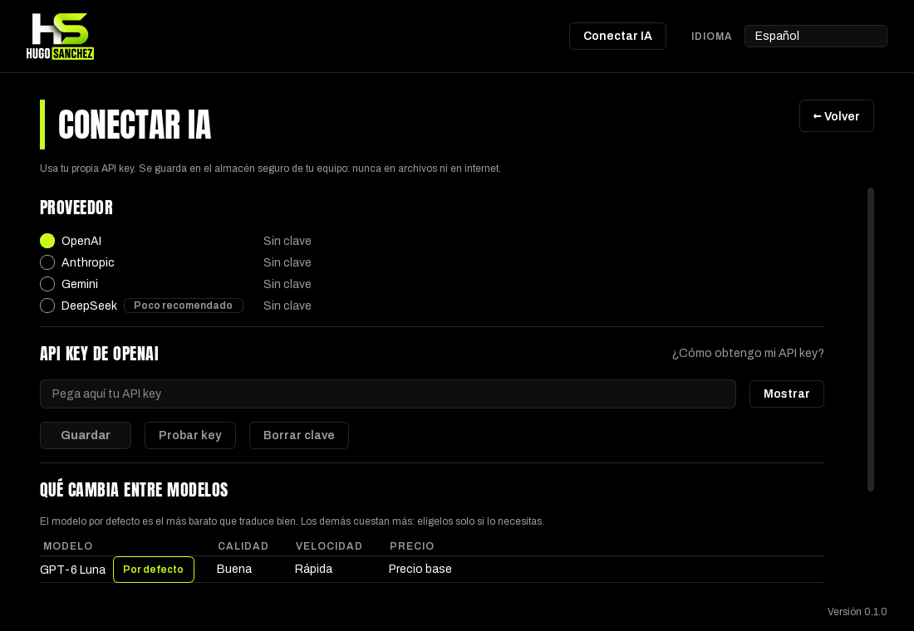</p>

> 🔒 **Tu key se guarda de forma segura en tu computadora y nunca se comparte.**

<p align="center"><a href="#indice">⬆️ Volver al índice</a></p>

<p align="center"></p>

<a id="problemas"></a>
<p align="center">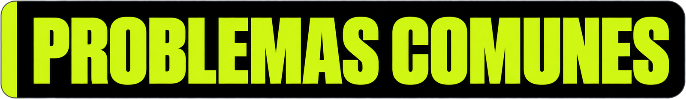</p>

**La app no abre.**
Revisa los requisitos y sigue los pasos de tu sistema en las secciones de instalación.

**Dice «Ese código no es válido».**
Revisa que lo copiaste completo, con el formato `HS-XXXX-XXXX-XXXX`.

**Dice «Tu código venció».**
Toca otra vez el botón en el Discord de la mentoría, recibe un código nuevo y pégalo en la app.

**Dice «Tu acceso está bloqueado».**
Escribe a un mentor para resolverlo. Cuando esté resuelto, pulsa **Activar**.

**Dice «Tu código ya se usa en 2 equipos».**
Si cambiaste de computadora, escribe a un mentor para liberar un lugar y luego pulsa **Activar**.

**Dice que no hay conexión con el servicio de acceso.**
Revisa tu internet y vuelve a intentar.

**Dice que la clave de IA no es válida.**
Entra a **Conectar IA**, vuelve a pegar la key completa y pulsa **Probar key**. Revisa que sea del proveedor que elegiste.

**Dice que no tengo crédito.**
Carga saldo en tu cuenta del proveedor de IA y retoma el trabajo: lo ya traducido queda guardado.

**Se cortó una traducción, ¿cómo sigo?**
Abre la app: te ofrece **Continuar** el trabajo sin terminar. Lo ya traducido no se paga dos veces.

**¿Dónde se guarda lo copiado?**
En la carpeta que elijas en el último paso (por ejemplo, Documentos), como un archivo CSV.

<p align="center"><a href="#indice">⬆️ Volver al índice</a></p>

<p align="center"></p>

<a id="preguntas"></a>
<p align="center">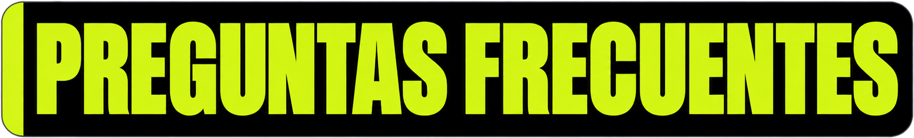</p>

**¿Cuánto cuesta traducir?**
Depende del idioma, del largo de los textos y del modelo. Antes de empezar la app te muestra un costo estimado en rango. Con el modelo más barato suelen ser centavos por producto, y el modo económico cuesta la mitad.

**¿Qué pasa si se acaba el crédito?**
La traducción se detiene. Carga saldo en tu cuenta del proveedor y continúa: lo ya traducido queda guardado y no se paga dos veces.

**¿Puedo traducir cualquier idioma?**
Puedes elegir entre los idiomas que ofrece la app. La calidad depende del modelo de IA que uses.

**¿Mi catálogo o mi clave se envían a algún servidor tuyo?**
No. Tu clave se guarda en tu computadora y solo viaja al proveedor de IA que elijas. El único servicio nuestro valida tu código de acceso; no ve tu clave ni tu catálogo. Las fotos de **Cambiar fondo** viajan solo al proveedor de IA que elijas (OpenAI o Gemini).

**¿Cómo me actualizo?**
La app avisa sola cuando hay una versión nueva. En **Windows** se actualiza al reiniciarla. En **Mac** debes reemplazarla a mano: descarga la nueva y arrástrala a Aplicaciones.

<p align="center"><a href="#indice">⬆️ Volver al índice</a></p>

<p align="center"></p>

<p align="center"><b>💬 Soporte:</b> abre un ticket en el Discord de la mentoría.</p>
